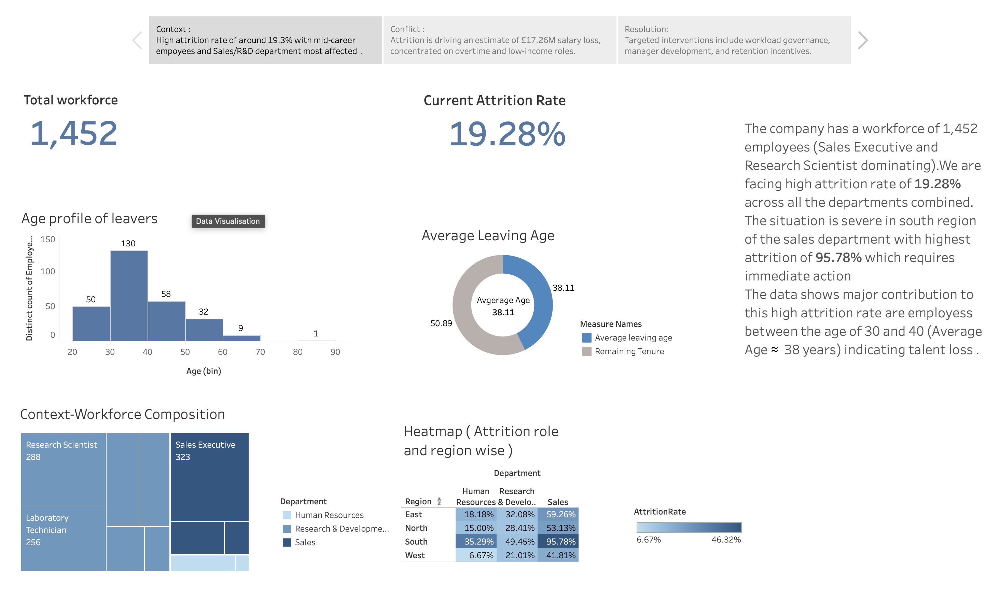
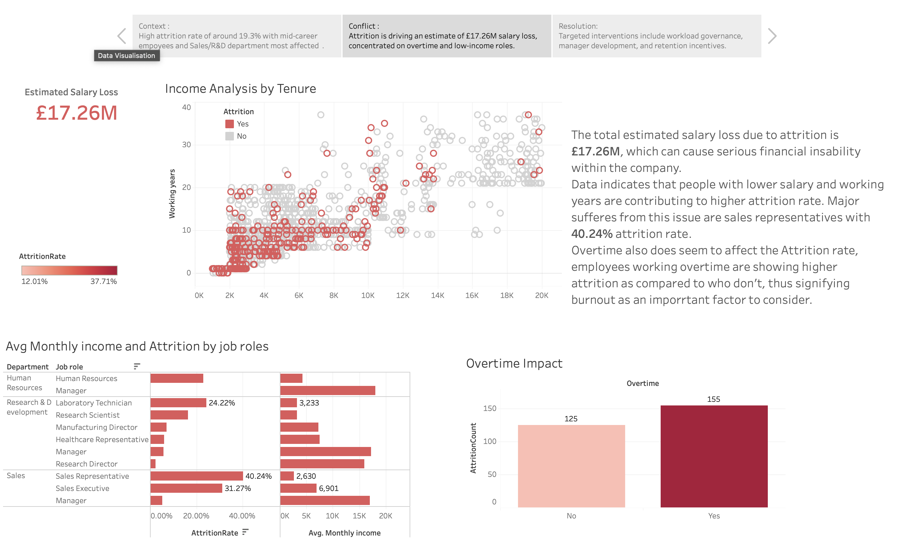
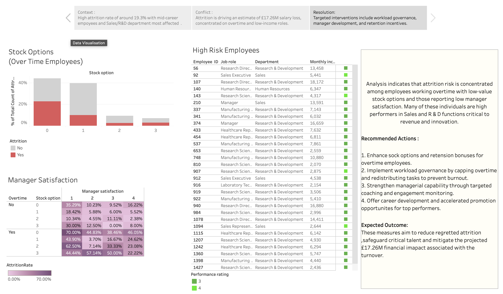
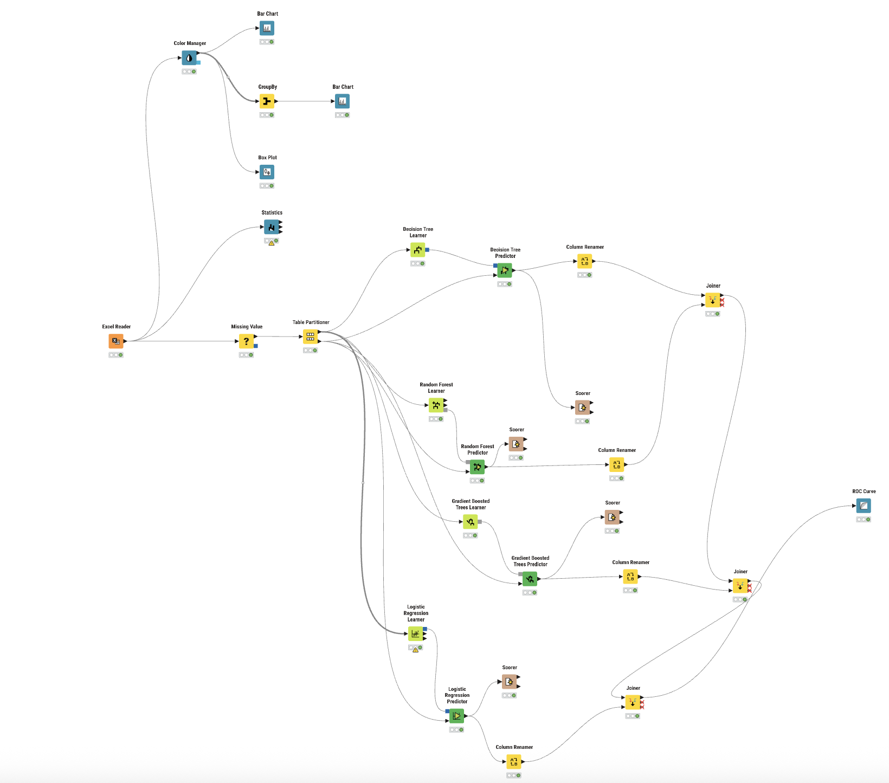
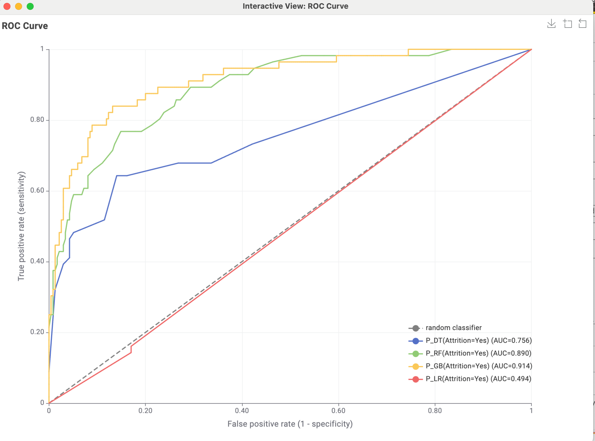
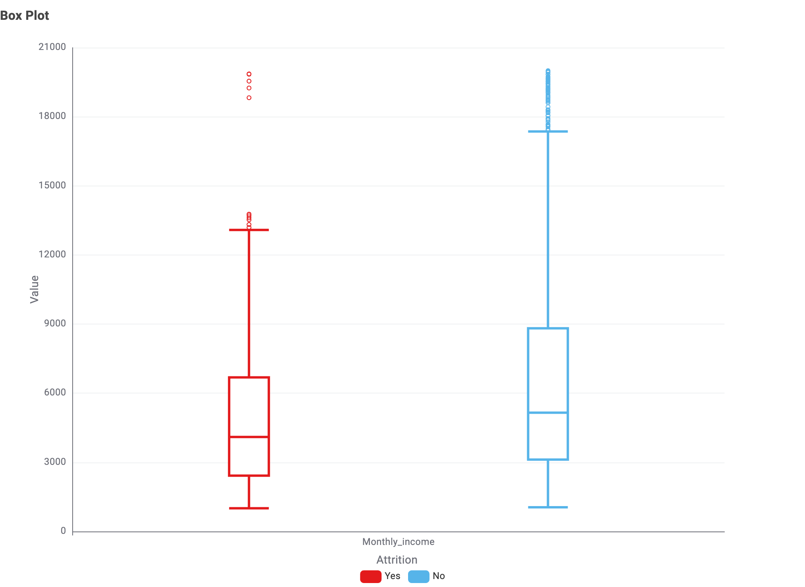
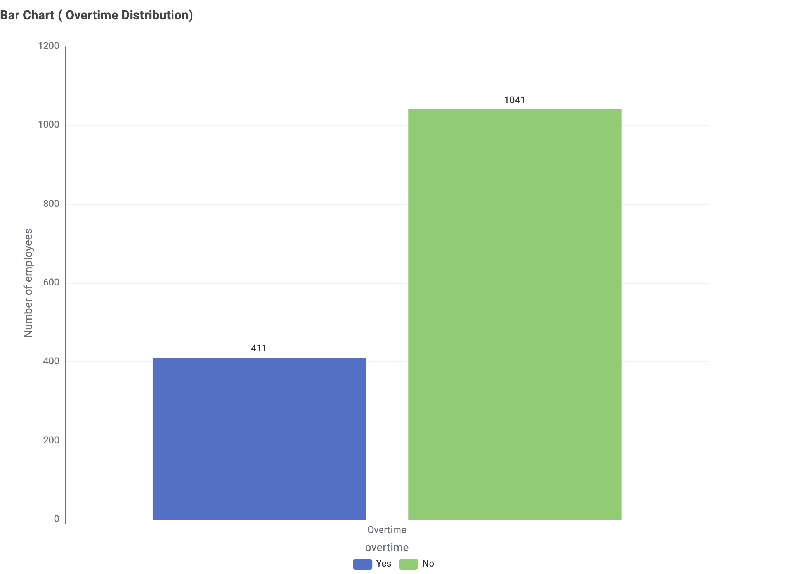

# Who Is Leaving, Why, and What Does It Cost? Employee Attrition Analytics

**MSc Business Analytics: HR Analytics (December 2025)**
**Author:** Ria Goel  ·  **Tools:** Tableau (storyboard) · KNIME Analytics Platform (ML workflow) · R (data cleaning)

> A pharmaceutical company (pseudonym "Pharmeasy Ltd.", 1,452 employees) is losing nearly **1 in 5 staff**. This project uses a **Tableau** storyboard to diagnose *who* is leaving and what it costs, then builds and compares **four machine learning models in KNIME** to predict *which* employees are at risk, ending with targeted retention recommendations for senior management.

---

## Key results at a glance

| | Result |
|---|---|
| **Attrition rate** | **19.28%** (280 of 1,452 employees) |
| **Estimated cost of turnover** | **£17.26 million** (salary-based estimate) |
| **Hotspots** | Mid-career employees aged 30–40 (average leaving age about 38). Sales Representatives have attrition above 40% |
| **Key drivers** | Low monthly income, short tenure, **overtime**, low-value stock options, low satisfaction with their manager |
| **Best model** | **Gradient Boosted Trees: ROC-AUC 0.914**, F1 (leavers) 0.645, Cohen's κ 0.581 |
| **High-recall alternative** | Random Forest: catches **85.2%** of actual leavers (recall), with ROC-AUC 0.890 |

---

## Part 1: Tableau storyboard (Context → Conflict → Resolution)

The storyboard follows a three-act narrative structure, so that non-technical HR leaders can follow the problem, its cost and the response.

**1. Context: who is leaving?**
Workforce composition, the age profile of leavers, and a heatmap of attrition by department and region.


**2. Conflict: what is it costing and why?**
The £17.26M salary loss, income vs tenure, attrition by job role, and the impact of overtime.


**3. Resolution: where to act**
Stock options for employees who work overtime, the link between manager satisfaction and attrition, and a list of high-risk, high-performing employees.


Full storyboard: [`tableau/Tableau_Storyboard.pdf`](tableau/Tableau_Storyboard.pdf)

## Part 2: Predictive modelling in KNIME

### Data preparation (R, then KNIME)
- **Merged duplicate category labels**, e.g. "HR" and "Human Resources" became one class. Shortened values such as "Y" in Overtime were standardised to "Yes", and stray case and spacing were fixed.
- **Applied range checks** to remove impossible values: age limited to 18–101, years at company to 80 or fewer, total working years to 106 or fewer.
- **Removed duplicates and checked for missing values**. In KNIME, remaining numeric gaps were filled with the median and text gaps with "Unknown".

### Workflow



| Stage | KNIME nodes | Configuration |
|---|---|---|
| Ingest & EDA | Excel Reader → Statistics, Color Manager, GroupBy, Bar Chart, Box Plot | Class balance, income vs attrition, overtime |
| Prepare | Missing Value → **Table Partitioner** | **80/20 stratified** on Attrition, fixed seed |
| Model | Decision Tree · Random Forest · Gradient Boosted Trees · Logistic Regression (Learner → Predictor) | DT: Gini + MDL pruning · RF: 100 trees, √p features per split · GBT: 100 trees, depth 4 · LR: SAG solver |
| Evaluate | Scorer (×4) → Column Renamer → Joiner → **ROC Curve** | Confusion matrices, accuracy, Cohen's κ, ROC-AUC comparison |

### Model performance (test set, positive class = Attrition "Yes")

| Model | ROC-AUC | Precision | Recall | F1 | Accuracy | Cohen's κ |
|---|---|---|---|---|---|---|
| Logistic Regression | 0.494 | 0.143 | 0.167 | 0.154 | 0.698 | −0.029 |
| Decision Tree | 0.756 | 0.411 | 0.697 | 0.517 | 0.852 | 0.436 |
| Random Forest | 0.890 | 0.411 | **0.852** | 0.554 | 0.873 | 0.490 |
| **Gradient Boosted Trees** | **0.914** | **0.536** | 0.811 | **0.645** | **0.887** | **0.581** |



**What this means**
- The tree ensembles far outperform the linear baseline. Attrition is driven by **non-linear interactions** (pay × workload × tenure × role), which logistic regression could not capture: it performed no better than random.
- **Accuracy is not the metric to use.** With about 80% of employees staying, a model can look accurate while missing leavers. Instead, models were judged on recall (missed leavers are costly), precision (wasted retention spend) and κ.
- **Gradient Boosting** gives the best overall balance and is the recommended main model. **Random Forest** is a high-recall option for critical, hard-to-replace roles.

 

## Recommendations for senior management
1. **Workload governance:** cap and monitor sustained overtime in high-risk teams and redistribute tasks.
2. **Reward alignment:** target retention bonuses and stock options at at-risk employees, especially high performers working overtime.
3. **Manager capability:** coaching, engagement monitoring and team-level retention accountability in the hotspots identified.
4. **Career paths:** structured progression for mid-career staff (ages 30–40), who make up most of the leavers.
5. **Deploy the model monthly with two thresholds:** high recall for critical roles, higher precision for the wider workforce.

## Repository structure

```
├── README.md
├── tableau/
│   ├── Tableau_Storyboard.pdf            # Full storyboard incl. references
│   └── 01–03_*.png                       # Storyboard pages
├── knime/
│   └── HR_Analytics_Attrition.knwf       # KNIME workflow (import via File → Import KNIME Workflow)
├── figures/                              # Workflow, ROC curves, performance table, EDA
├── reports/
│   └── HR_Analytics_Report.pdf           # Full report (storyboard narrative + modelling)
└── data/README.md                        # About the data
```

## How to open the workflow
1. Install [KNIME Analytics Platform](https://www.knime.com/downloads), which is free.
2. **File → Import KNIME Workflow…** and select `knime/HR_Analytics_Attrition.knwf`.
3. The data isn't included (see [`data/README.md`](data/README.md)). To re-run, point the **Excel Reader** node at your copy of the dataset and execute all nodes.

## Skills demonstrated
`Tableau` · `data storytelling` · `dashboard design` · `KNIME` · `R` · `data cleaning` · `classification` · `Gradient Boosting` · `Random Forest` · `Decision Tree` · `Logistic Regression` · `imbalanced data evaluation` · `ROC-AUC` · `Cohen's kappa` · `people analytics` · `HR analytics` · `stakeholder recommendations`

---

*AI was used to help structure the report and to format results tables, as declared in the report. The analysis, modelling and conclusions are the author's own.*
